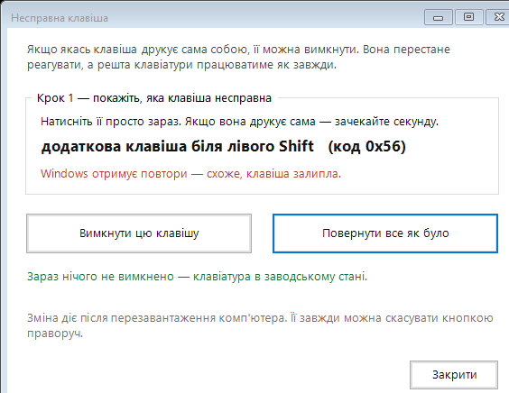

# KeyFix — вимкнути залиплу клавішу


Клавіша, якої ніхто не тримає, раз по раз друкує свій символ — у документі,
у полі пошуку, у паролі під час входу. Це замкнув контакт у клавіатурі.
Програмно його не вилікувати, але несправну клавішу можна **вимкнути на рівні
драйвера**, і вона перестане заважати.

Один файл, нічого не встановлює, зміна скасовується тією ж програмою.



---

## Швидкий старт

1. Завантажте `KeyFix.cmd` із [розділу Releases](../../releases) або з теки [`dist/`](dist/).
2. Запустіть подвійним клацанням. Програма сама попросить права адміністратора.
3. Натисніть несправну клавішу — програма покаже, яка це і з яким кодом.
4. **«Вимкнути цю клавішу»** → підтвердити.
5. **Перезавантажте комп'ютер.** Без цього нічого не зміниться.

Передумати можна будь-коли: запустіть ще раз і натисніть **«Повернути все як було»**.

---

## Як це працює

Windows тримає у реєстрі параметр `Scancode Map`:

```
HKEY_LOCAL_MACHINE\SYSTEM\CurrentControlSet\Control\Keyboard Layout
```

Його читає драйвер класу клавіатури — **до розкладок і до будь-якої програми**.
Тому вимкнена клавіша мовчить скрізь: у застосунках, на екрані входу, у вікнах
UAC, у BitLocker-запиті.

Формат параметра:

| Байти | Що це |
|---|---|
| 0–3 | версія, завжди нулі |
| 4–7 | прапорці, завжди нулі |
| 8–11 | кількість записів **разом із кінцевиком** |
| далі по 4 | правило: `куди` (2 байти) + `звідки` (2 байти), обидва little-endian |
| останні 4 | кінцевик, нулі |

Вимкнути клавішу означає відобразити її «в нікуди», тобто `куди = 0x0000`.
Наприклад, для скан-коду `0x56`:

```
00 00 00 00  00 00 00 00  02 00 00 00  00 00 56 00  00 00 00 00
                          ^^ 1 правило + кінцевик    ^^ 0x56 -> нікуди
```

Розширені клавіші (ті, що йдуть із префіксом `E0` — стрілки, правий Ctrl,
«Меню») записуються як `0xE0xx`, тобто старший байт `E0`.

### Чому не програма-перехоплювач

Поширений спосіб — тримати в пам'яті скрипт (AutoHotkey й подібні), який ловить
натискання. Він підводить саме тоді, коли потрібен:

- **стартує лише після входу** — пароль ви вже набрали з «подарунком»;
- **мовчить у вікнах із правами адміністратора**, якщо сам запущений без них;
- **гине разом зі своїм процесом** — і захист зникає;
- **наздоганяє, а не блокує**: опитування вже після того, як натискання пішло
  у вікно, тож перший символ завжди проскакує.

`Scancode Map` нічого з цього не має, бо працює рівнем нижче.

---

## Що програма вміє

**Читає сирий скан-код** просто з повідомлення Windows, а не вгадує його через
розкладку. У `lParam` повідомлення про натискання: біти 16–23 — апаратний
скан-код, біт 24 — ознака розширеної клавіші, **біт 30 — чи це вже повтор**.

Останній і викриває залипання: коли клавіша не відпускається, Windows шле
автоповтори, і програма пише про це прямо.

**Показує модифікатори.** Якщо символ народжується сполученням (`AltGr + літера`),
видно, що саме утримується. Вимкнути сполучення неможливо — драйвер бачить лише
окремі натискання, — і програма про це чесно попереджає.

**Стереже залиплий модифікатор.** Якщо `Ctrl`, `Alt` чи `Shift` значаться
натиснутими, коли людина нічого не тримає, програма скаже, що винен саме він,
а не літера.

**Не дає вимкнути життєво важливе.** `Enter`, пробіл, `Backspace`, `Shift`,
`Ctrl`, `Alt` заблоковані — інакше комп'ютер можна зробити непридатним.

---

## Поширені скан-коди

| Код | Клавіша | Що на ній в українській розкладці |
|---|---|---|
| `0x56` | додаткова біля лівого `Shift` (102-га) | ґ |
| `0x2B` | `\` біля `Enter` | ґ (залежить від розкладки) |
| `0x28` | `'` | є |
| `0x1B` | `]` | ї |
| `0x1A` | `[` | х |
| `0x27` | `;` | ж |
| `0x3A` | `Caps Lock` | — |
| `0xE05D` | «Меню» | — |
| `0xE01D` | правий `Ctrl` | — |
| `0xE038` | правий `Alt` (AltGr) | — |

Не знаєте коду — відкрийте [`tools/ScancodeDetector.html`](tools/ScancodeDetector.html)
у будь-якому браузері й натисніть клавішу. Сторінка покаже код, ознаку
самоповтору й готовий рядок для консольної версії.

---

## Складання з джерел

```powershell
# з кореня репозиторію
.\build\Build-Standalone.ps1
```

Складальник бере [`src/KeyFix.Gui.ps1`](src/KeyFix.Gui.ps1), кодує його в base64
і вбудовує у `dist/KeyFix.cmd`.

### Дві пастки, на яких це ламалось

**Межа командного рядка cmd.exe.** Перша версія складала base64 у змінну через
`set "B=!B!..."`. Межа — 8191 символ, і при відкладеному розгортанні `!B!` у неї
рахується **весь накопичений вміст**, а не довжина рядка у файлі. Щойно змінна
переростала межу, cmd мовчки переставав дописувати: з 17000 символів доїжджало
8100, програма розпаковувалась наполовину й не запускалась — без жодної помилки.
Тепер шматки пишуться у файл, де меж немає.

**Рядок, що закінчується цифрою.** `echo abc1>>файл` cmd читає як
перенаправлення потоку `1>>`. У base64 цифри трапляються постійно, тому кожен
`echo` обгорнуто в дужки: `(echo abc1)>>файл`.

Складальник перевіряє себе: що у `.cmd` немає не-ASCII символів і що жоден
рядок не наблизився до межі.

---

## Структура

```
src/KeyFix.Gui.ps1          вікно (WinForms) — те, що бачить людина
src/KeyFix.Console.ps1      консольне меню для майстерні
build/Build-Standalone.ps1  збирає dist/KeyFix.cmd
tools/ScancodeDetector.html визначник скан-коду в браузері
docs/USAGE-uk.txt           інструкція для клієнта
dist/KeyFix.cmd             зібраний файл, готовий до надсилання
```

---

## Застереження

**Це не ремонт.** Клавіша лишається несправною фізично — ми лише навчили Windows
її ігнорувати. Якщо згодом почне збоїти сусідня, клавіатура сиплеться далі,
і її варто замінити.

**Параметр у системі один.** `Scancode Map` спільний для всієї клавіатури, тож
новий запис замінює попередні перевизначення. Програма показує поточний стан
угорі вікна.

**Антивірус і SmartScreen** можуть насторожитись: файл просить права
адміністратора й пише в реєстр. Підпису в нього немає.

---

## English

**KeyFix** disables a stuck keyboard key through the Windows `Scancode Map`
registry value, so the key goes silent everywhere — including the logon screen
and UAC prompts, where a user-space key blocker cannot reach.

Single self-extracting `.cmd`, no installation, fully reversible. The UI is in
Ukrainian. It reads the **raw scancode from the Windows message** (`lParam`
bits 16–23, extended flag in bit 24, auto-repeat in bit 30), so it identifies
the physical key rather than guessing through the active layout, and refuses to
disable keys you cannot work without.

---

## Ліцензія

[MIT](LICENSE)
